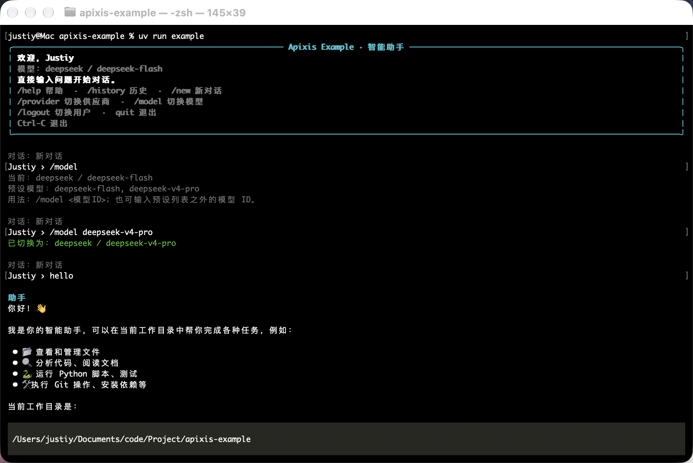

<div align="center">

# Example · Apixis Agent


[](https://github.com/JJJJSTIYYYY/apixis-example/blob/main/LICENSE)
[](https://discord.gg/tUCQthwK5)
[](https://qun.qq.com/universal-share/share?ac=1&authKey=ommoQrT2zhzHU%2FUxv8pfGCJbNifW%2BJyUAFBkNdzkHTPUxdxCnlgxm5aNgGslTmdE&busi_data=eyJncm91cENvZGUiOiI2Mzk0NTkxNzIiLCJ0b2tlbiI6Im9ZZkdNUWZnSVV1Y2REeUhKNnlTbWEwc05Bb093djRzUXdXNE55dklBVnlBQk9XbGNpS0ZXSDlzK3orSW1sQ3YiLCJ1aW4iOiIzMTI5NDI0NTcyIn0%3D&data=OGTchcr80RAQg8Z8_GZTdvBb7kZDeM9B3hHcNqLaAX2ZK_KYq260C4CubblEBT1bK5fP6zgtnCk2D8fIoph1ZQ&svctype=4&tempid=h5_group_info)

**由事件驱动，支持插件、多模型供应商的命令行 Agent**

</div>

一个终端智能助手演示项目，展示 Apixis 的图调度、事件和恢复能力，以及 my-llm-py 的多供应商模型调用。支持 DeepSeek、Kimi、OpenAI 等供应商的流式对话、逐次审批终端命令，以及自动保存和继续历史对话。项目、Python 包和命令均为 `example`。

## 预览

<div align="center">
  
</div>

## 启动

需要 uv，项目使用 Python 3.14、Apixis 1.1.5 和 my-llm-py 1.3.2（包含全部供应商 SDK）。uv 会根据 `.python-version` 准备解释器。

```bash
uv sync --locked
# Enter your own key for this shell session; no credential file is required.
read -r -s DEEPSEEK_API_KEY
export DEEPSEEK_API_KEY
uv run example
```

默认使用 DeepSeek / `deepseek-flash`。进入对话后用命令切换供应商和模型：

```text
/provider                         查看当前供应商与可用供应商
/provider kimi                    切换到 Kimi
/provider kimi-cn                 切换到 Kimi 中国站
/model kimi-k2.7-code             切换到预设模型
/provider openai gpt-6.1-sol        同时选择供应商和模型
/model                            查看当前模型与预设模型
```

预设已按 2026-10-16 的官方文档核查，包含六个供应商的 18 个模型，详见 [预设及来源](docs/guides/model-presets.md)。也可输入账户可用的其他模型 ID。切换后立即使用新选择，
完整保留当前对话、工具结果、最近工具输出和失败快照；`/retry` 使用新选择恢复旧快照。
跨供应商、跨 API 的消息转换交给 my-llm-py，转换失败时显示错误并保留状态。

也可用启动参数指定初始选择，适用于交互和单次模式：

```bash
uv run example --provider kimi --model kimi-k3
uv run example --provider openai --model gpt-6.1-sol --prompt '你好'
```

API Key 从环境变量读取，选择供应商和模型不需要凭证；实际发起模型请求时才检查。

| 供应商 | API / 协议 | 凭证环境变量 |
| --- | --- | --- |
| `deepseek` | OpenAI Chat Completions | `DEEPSEEK_API_KEY` |
| `kimi` | OpenAI Chat Completions | `KIMI_API_KEY` 或 `MOONSHOT_API_KEY` |
| `kimi-cn` | 同一 Kimi 模型目录，中国站连接 | `KIMI_API_KEY` 或 `MOONSHOT_API_KEY` |
| `openai` | OpenAI Responses | `OPENAI_API_KEY` |
| `anthropic` | Anthropic 原生 | `ANTHROPIC_API_KEY` |
| `gemini` | Gemini 原生 | `GEMINI_API_KEY` 或 `GOOGLE_API_KEY` |
| `ollama` | Ollama 原生 | 无需凭证 |

`LLM_API_KEY` 可作为通用凭证；优先使用当前供应商专属的凭证变量。
`kimi` 使用国际站 `api.moonshot.ai`，`kimi-cn` 使用中国站 `api.moonshot.cn`，请按密钥所属站点选择；应用不会自动向另一站重发。
`EXAMPLE_HOME` 仍控制设置和历史保存目录（默认 `~/.example`）。
模型调用的配置不再读取 `LLM_PROVIDER`、`LLM_MODEL`、API 地址或 token 上限等环境变量。
地址、API 类型、输出上限和能力差异直接在 `core/providers.py` 使用库原生的
`ProviderProfile`、`ModelProfile` 声明，见 [my-llm-py 接入说明](docs/guides/my-llm-coverage.md)。

项目目录里的 `config.yaml` 使用 `LOG.show_event_dispatch` 控制额外的事件分发输出；1.1.5 已移除旧的 `debug_level`、`trace` 日志配置。Apixis 从**运行命令时的工作目录**加载该文件。可添加 `PIPELINE.event_loop_backpressure` 和 `PIPELINE.event_pipe_max_len` 调整容量，背压下限为 128。

## 使用

首次启动填写显示名称，之后直接输入问题。例如：“帮我解释这段报错”或“查看当前目录，说明项目结构”。回复完成后会自动保存；输入 `/history` 可以选择已有对话继续聊天。

输入 `/logout` 可退出当前用户并回到用户名输入界面，已保存的历史会保留。在用户名输入界面输入 `/list-user` 可列出已记录的用户（包括已有历史中的用户），然后输入其中一个用户名或新用户名。切换用户后从新对话开始，可用 `/history` 恢复该用户的历史。

需要执行工具时，界面会先展示完整命令和工作目录，再逐个请求审批。回车或 `y` 批准，Esc 或 `n` 拒绝。命令守卫会直接拒绝匹配到的危险命令。执行结果按实际退出码区分成功和失败；拒绝会显示“工具已跳过”。

| 命令 | 行为 |
| --- | --- |
| `/help` | 显示全部命令及工具审批操作说明 |
| `/provider [供应商] [模型ID]` | 查看或切换供应商，保留对话和重试状态 |
| `/model [模型ID]` | 查看或切换当前供应商的模型，保留对话和重试状态 |
| `/history` | 选择并继续当前用户名的历史对话 |
| `/new` | 开始新对话，清除当前重试记录 |
| `/rename`、`/delete` | 重命名或删除当前对话 |
| `/output` | 查看最近一次工具的完整输出 |
| `/usage` | 查看当前用户会话最近 20 次完成请求的 token 用量 |
| `/transcript` | 查看当前对话的完整记录 |
| `/retry` | 从最近一次失败运行的最新快照恢复 |
| `/logout` | 退出当前用户，清空当前对话和重试状态，重新询问用户名 |
| `/list-user` | 仅在用户名输入界面可用，列出已记录的用户 |
| `quit`、`exit`、`q`、Ctrl-C | 退出 |

长工具输出先显示摘要，输入 `/output` 查看全文。打开历史时先预览最近 3 轮，输入 `/transcript` 查看完整对话；模型仍会使用完整历史。在终端中长记录使用分页器，通常按 `q` 返回；输出重定向时直接打印全文。历史选择输错序号会提示重新输入，回车返回当前对话。

下面两条命令用于了解 Apixis 的运行情况，不需要在普通聊天中使用：

| 命令 | 行为 |
| --- | --- |
| `/checkpoints` | 查看最近运行的状态、快照版本和恢复目标 |
| `/stats` | 查看当前会话的运行事件和工具事件计数 |

每轮开始时，工作目录子图并发采集少量目录名称与运行环境，再合并为临时上下文。不会读取文件内容或环境变量，也不会额外请求 LLM。临时环境信息不写入对话历史，子图使用 `no_snapshot=True`。

工具审批通过 Apixis 的 `Block.accept()` 延后到流消费者处理；批准或拒绝调用 `resolve()`，界面错误调用 `fail()`，取消调用 `cancel()`。审批与发起它的运行关联，关闭流或中止运行时由 Apixis 清理，无需另建 Future。

`/usage` 使用 my-llm-py 的 `get_last_usage()`，通过 Apixis 流传递独立用量事件，包含输入、输出、总计、缓存与推理 token。一次工具回合可能包含多次模型请求；未报告的字段显示 `—`。记录不进入对话、SQLite 或快照，退出当前用户时清空。失败或截断请求不计入完成记录，记录也不代表完整账单。

工具以独立事件请求执行，通过唯一回复事件等待结果。审批不设超时；shell 命令执行上限为 30 秒，事件结果等待上限为 40 秒，LLM 节点上限为 130 秒。主图默认最多 32 个节点步骤，每执行一个工具占用一个步骤。

### 快照与重试

快照由 Apixis 在节点执行前自动保存。`/retry` 恢复的是新 context，不会重新使用已经消耗的失败 context。

默认只保留最近 16 个快照，使用 `--max-snapshots N` 调整交互和单次模式的保留条数。`/checkpoints` 显示当前条数与上限，版本索引指当前保留范围；裁剪旧快照不改变最新快照中的完整状态。

- 工具结果已提交、后续 LLM 请求失败：恢复到 LLM 节点，已提交的工具不会重跑。
- 工具节点自身失败：恢复可能重新执行该工具，仍需再次审批。节点快照不保证外部命令的 exactly-once 执行。
- 达到最大步数的运行应开始新一轮；`/retry` 保留快照的步数，不增加额度。
- 输入被过滤的运行不会调用 LLM，也不写入历史。
  插件通过 `GraphContext.stream_writer()` 发送 `type="error"` 的消息（包含 `message` 和 `hint`），再用 `event.accept()` 中止调度；调用方直接消费流，无需读取 state 中的额外标记。
- 快照只属于当前进程中的编译图，**不支持退出后恢复**。SQLite 保存的是完成的对话，不是图运行快照。
- 切换、删除或新建对话后，旧失败运行不再可重试。
- `/provider`、`/model` 保留对话和旧失败快照；切换后 `/retry` 会使用当前选择的模型继续。

### 单次运行与本地检查

```bash
# No API key and no paid request; execute the concurrent workspace subgraph.
uv run example --check

# One turn, streamed to stdout, without writing settings or conversation history.
# Tools are rejected by default in this mode.
uv run example --prompt '不要调用工具。只回复 OK。'

# Explicitly approve guarded tools for this one prompt.
uv run example --prompt '执行 printf hello，然后说明结果' --approve-tools

# Adjust the step budget for one-shot mode.
uv run example --prompt '你好' --max-steps 16

# Keep only the latest four checkpoints per attempt.
uv run example --max-snapshots 4
```

单次模式也经过输入过滤和命令守卫。DeepSeek/Kimi 的输出预算直接配置在 `ModelProfile.extra_body`：DeepSeek 和 Kimi K2.x 使用 `{"max_tokens": 4096}`，Kimi K3 使用 `{"max_completion_tokens": 4096}`；1.3.2 中使用 `Config(default_value={...})` 包装 `extra_body`，Anthropic 也直接在其中配置 `max_tokens`。未显式配置时沿用现有默认值。

应用以标准 `openai_chat` 格式调用 my-llm-py 1.3.2，上游协议转换、工具参数组装与完整消息收集交给库。完成原因读取流事件的 `choices[*].finish_reason`，最终消息直接使用 `stream.result`。遇到 `length` 或库的 Responses incomplete/failed 异常时保留失败快照供 `/retry`，截断回复不写入历史；完成原因和用量不额外写入历史消息。1.3.2 的用量通过成功消费后的 `get_last_usage()` 获取，供应商公开流事件不再包含 usage；应用另行发送展示用量的图流事件。跨协议无法表达历史内容时，沿用库默认的 `SemanticLossError`，保留对话和快照，提示切回兼容供应商后重试。

## 结构

```text
src/example/
  __init__.py          CLI 参数与启动/关闭
  app.py               交互、单次运行、历史保存
  commands.py          原有历史命令
  core/
    runtime.py         会话资源、context 生命周期与快照恢复
    agent.py           prepare → workspace → agent ↔ tools
    workspace.py       并发子图：directory + environment → summary
    events.py          工具请求/回复、自定义运行事件、后台计数
    providers.py       my-llm-py 的供应商 Profile 预设
    llm.py             Profile 配置、标准 Chat 事件与 stream.result
    tools.py           工具注册与 shell 执行
    history.py         SQLite 历史
    settings.py        用户名与保存路径
  plugins/             输入过滤和命令守卫
  ui/                  终端输入、流式 Markdown 与组件
```

所有工具由应用提供，未启用 Provider 原生搜索或工具。输入过滤和命令守卫是简单模式检查，示例没有实现 shell 沙箱；交互模式保留逐次审批。工具完整输出交给模型，终端折叠显示并可查看全文。

完整文档见 [文档索引](docs/README.md)，接口覆盖与取舍见 [Apixis 接口覆盖](docs/guides/apixis-coverage.md)，测试方法和结果见 [验证说明](docs/validation.md)。

## 本地测试

```bash
uv run python -m unittest discover -s tests -v
```

测试不需要 API Key，也不会访问付费接口。覆盖真实 Apixis 图与事件流程、审批顺序、异常、恢复、中止、my-llm-py 与官方 SDK 的模拟传输、完整 Chat 消息与旧历史保存，以及窄窗口、长输出和历史交互；另在独立进程中验证背压 128、队列 8 下的 160 路并发。

可选的付费验证：`uv run python tests/scenarios/live_upgrade.py`，按隐藏提示输入 DeepSeek 和 Moonshot 密钥。每家最多两次模型请求，仅允许固定的 `printf APIXIS_UPGRADE_OK` 工具命令；验证延迟审批、工具后失败恢复、快照裁剪和用量。密钥只存在进程内存，脚本不保存设置、对话或日志。测试方法与覆盖范围见 [验证说明](docs/validation.md)。
中国站 Moonshot 密钥需加 `--kimi-region cn`；用 `--provider kimi` 可单独验证 Kimi。
